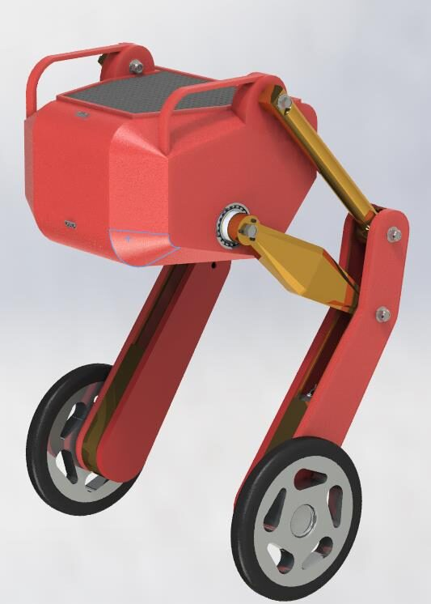
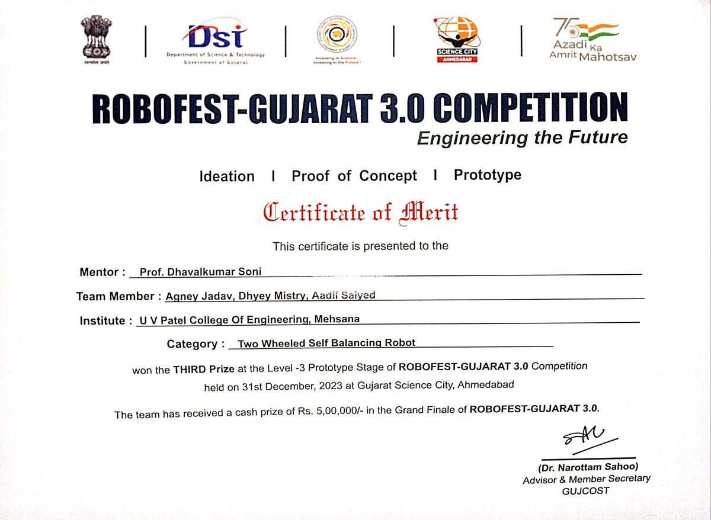

# Two-Wheeled Self-Balancing Robot with Leg Mechanism

**ROBOFEST-Gujarat 3.0 (GUJCOST) · 3rd prize, prototype stage · December 2023**
Team: Agney Jadav, Dhyey Mistry, Aadil Saiyed · Mentor: Prof. Dhavalkumar Soni · U. V. Patel College of Engineering, Ganpat University

[English](#english) · [Deutsch](#deutsch)

---

## English

### The idea
Most self-balancing robots only work on flat floors. We built a wheeled biped that keeps its body level on uneven ground: each wheel sits on a **4-bar linkage "knee"** driven by stepper motors, so the legs absorb obstacles while the body stays steady. The team won the **3rd prize at the prototype stage** and a team prize of ₹5,00,000 in the grand finale.

### Specifications
| | |
|---|---|
| Size | 69 × 40 × 46 cm |
| Controller | STM32F103C8T6 |
| Drive | 2 × NEMA 17 (wheels) + 2 × NEMA 17 with 1:19 planetary gearbox (legs), TMC2208 drivers |
| Sensors | LSM6DSO IMU, 2500 PPR rotary encoders, Sharp IR distance sensors |
| Power | 11.1 V, 8,000 mAh Li-ion pack with buck converters |
| Wheels | 225 mm, 3D-printed ABS rims with TPU tyres |
| Structure | 3D-printed PLA+ links and body, aluminium brackets |
| Control | Flysky 10-channel remote |
| Goals | Balance, carry 1 L of water over 200 m, change height while moving, lean, tackle obstacles, avoid collisions |

### What the team did
<!-- TODO (Agney): say which parts were yours -->
- Mechanical design of the leg linkage, wheel assembly and body in CAD
- Designed and 3D-printed the custom wheels (rigid rim, flexible TPU tyre) and structural parts
- Selected motors, drivers and sensors and planned the electronics layout

### Skills shown
`robotics` `mechanism design` `4-bar linkage` `CAD` `STM32` `stepper control` `IMU` `3D printing (PLA+, ABS, TPU)` `teamwork`

---

## Deutsch

### Idee
Ein zweirädriger, selbstbalancierender Roboter, dessen Räder an je einem **Viergelenk-"Knie"** hängen. So gleicht er Hindernisse aus, während der Körper ruhig bleibt. **3. Preis in der Prototyp-Stufe** bei ROBOFEST-Gujarat 3.0 (GUJCOST), Teampreis ₹5,00,000 im Finale.

### Technik
STM32-Steuerung, vier NEMA-17-Schrittmotoren (zwei mit Planetengetriebe 1:19), IMU, Drehgeber, IR-Sensoren, 11,1-V-Akku mit 8.000 mAh, 3D-gedruckte Räder aus ABS und TPU, Größe 69 × 40 × 46 cm.
